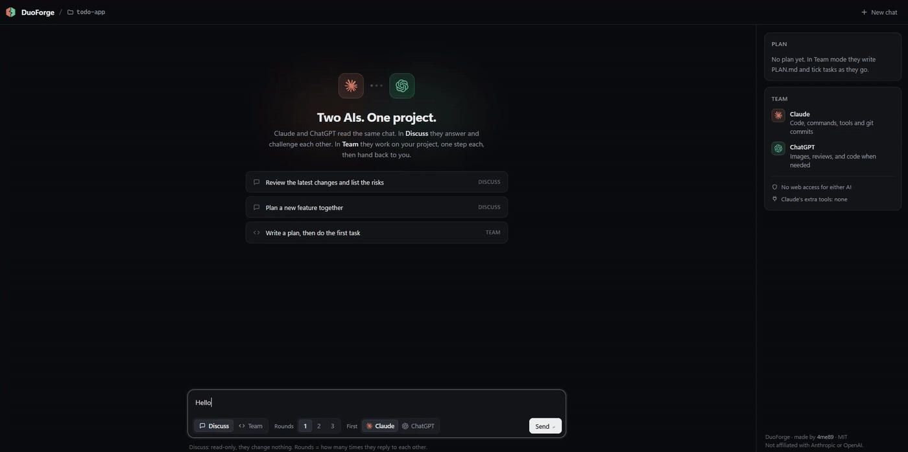

<p align="center"></p>

<h1 align="center">DuoForge</h1>

<p align="center"><b>Claude and ChatGPT, working together on your project — in one local chat.</b></p>

<p align="center"></p>

You write what you want. Claude answers, ChatGPT reads Claude's answer and replies (or the other way round).
In **Team** mode they really work: they share a plan, debate, take turns doing one step each, and hand back to you
when a decision is needed.

- **No API keys**: uses your own Claude Code and Codex (ChatGPT) logins — your subscriptions, on your machine.
- **Two modes**: *Discuss* (fast, read-only) and *Team* (they edit files, run tools, generate images).
- **Safe by default**: localhost only, per-launch secret, host check, no web access for either AI.

## Why use it?
- Get two opinions on every idea, bug or design choice, and let them correct each other.
- Split the work: one codes, the other makes images or reviews.
- Keep a shared `PLAN.md` so the project moves step by step.

## Quick start
Node 18+, Claude Code CLI and Codex CLI logged in. Then point DuoForge at your project and start it:
```bat
set DUO_PROJECT=C:\path\to\your\project
node server.js
```
Open http://localhost:4747. On Windows you can also double-click `lancer.cmd`: it asks for the project folder.
Full guide (also for your AI assistant): [SETUP.md](SETUP.md).

## Credits
Made with ❤️ by **[4me89](https://github.com/4me89)**. If DuoForge helps you, leave a ⭐!

The logo was designed by ChatGPT and redrawn as SVG by Claude. The Claude and OpenAI icons come from
[Simple Icons](https://simpleicons.org) (CC0).

Claude is a trademark of Anthropic. ChatGPT and OpenAI are trademarks of OpenAI. DuoForge is an independent
project, not affiliated with or endorsed by Anthropic or OpenAI.

## License
MIT © 4me89
